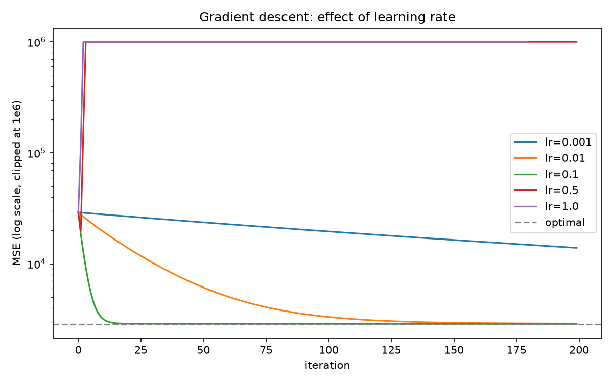

# ML From Scratch (NumPy)

Linear regression, logistic regression and a decision tree, implemented with only NumPy and checked against scikit-learn. scikit-learn is used **only** as the reference in `compare_with_sklearn.py`.

## What's inside

| File | What it does |
|------|--------------|
| `linear_regression.py` | Linear regression via gradient descent **and** via the normal equation (least squares) |
| `logistic_regression.py` | Binary logistic regression: stable sigmoid, cross-entropy, gradient descent, optional L2 |
| `decision_tree.py` | Decision tree classifier: Gini impurity, greedy best split, sort + cumulative-count trick |
| `utils.py` | `StandardScaler`, `r2_score`, `accuracy` |
| `compare_with_sklearn.py` | Runs each model against scikit-learn and prints a comparison |
| `experiment_learning_rate.py` | Gradient descent at 5 learning rates, saves `lr_experiment.png` |

## Run it

```
python -m venv venv
venv\Scripts\activate            # Mac/Linux: source venv/bin/activate
pip install -r requirements.txt
python compare_with_sklearn.py
python experiment_learning_rate.py
```

## Results

Dataset splits: 80/20, `random_state=42`. Features standardized with my own `StandardScaler` for the linear and logistic models.

| Model | Dataset | Scratch | scikit-learn | Agreement |
|-------|---------|---------|--------------|-----------|
| Linear (normal equation) | diabetes | R² 0.4526 | R² 0.4526 | predictions identical |
| Linear (gradient descent) | diabetes | R² 0.4526 | R² 0.4526 | max prediction diff 0.047 |
| Logistic (L2, C=1) | breast cancer | 98.25% acc | 98.25% acc | 100% of predictions; max probability diff 0.02 |
| Decision tree (depth 5) | breast cancer | 92.11% acc | 92.11% acc | 100% of predictions |

### Learning-rate experiment (linear regression, 200 iterations)

Optimal MSE from the normal equation: 2859.70

| Learning rate | Final MSE | Result |
|---------------|-----------|--------|
| 0.001 | 13922.19 | too slow, still far from optimal |
| 0.01 | 2889.76 | close, not quite converged |
| 0.1 | 2871.02 | converged |
| 0.5 | overflow | diverged |
| 1.0 | overflow | diverged |



## What I found (including a mistake)

- **My first logistic comparison didn't match.** Against scikit-learn with *no* regularization, my model scored 97.4% vs scikit-learn's 92.1%, with only 93% prediction agreement. The breast cancer data is easy to separate with 30 features, so the unregularized optimum has weights that keep growing, and where a solver stops depends on its stopping rule (scikit-learn's solver vs. my 5000 fixed steps). I haven't proved separability, but adding the same L2 penalty to both sides (`l2 = 1 / (C * n)`) made them agree 100%, which supports this explanation.
- **Gradient descent needs scaled features.** I standardize before fitting. Without it the learning rate that works for one feature diverges for another.
- **Too-high learning rate fails loudly, too-low fails quietly.** At 0.5 the loss exploded within a few steps; at 0.001 it just crawled.
- **Why gradient descent is slightly off the normal equation (0.047):** it stops after a fixed number of steps; the diabetes features are correlated, which makes the last bit of convergence slow. I haven't run it long enough to confirm.
- **Decision tree trick:** instead of re-scanning the data for every candidate threshold, sort each feature once and use cumulative class counts, so every threshold is scored in constant time.

## Limitations

- Binary logistic regression only; the tree is classification only.
- Tree ties between equally good splits can differ from scikit-learn's choice; on this split the predictions matched exactly, but that's not guaranteed on every dataset.
- Batch gradient descent only (no mini-batch or momentum).
